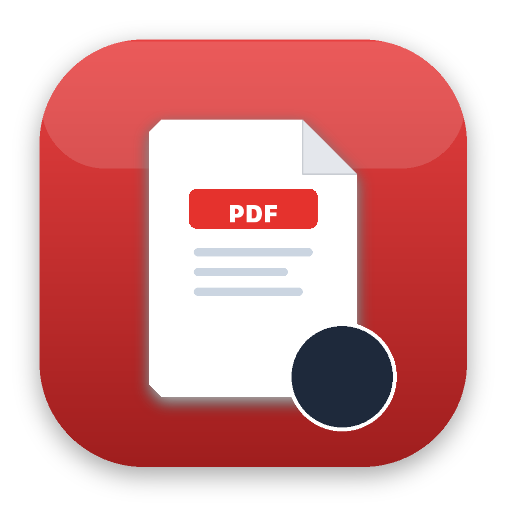

<p align="center">
  
</p>

<h1 align="center">PDF Tool para macOS</h1>

<p align="center">
  <strong>Utilitário nativo, elegante e 100% offline para manipular, organizar e converter arquivos PDF no Mac.</strong>
</p>

<p align="center">
  
  
  
  
  
</p>

---

## 🎯 Por que o PDF Tool?

Ao contrário da maioria dos serviços de PDF online que exigem o upload de seus dados confidenciais para servidores na nuvem, o **PDF Tool** roda **100% localmente no seu Mac**.

Seus extratos bancários, contratos, faturas e documentos pessoais nunca saem do seu computador.

* ⚡ **Ultra Leve e Rápido:** Binário Universal nativo ocupando menos de 3 MB.
* 🔒 **Segurança Total:** Zero conexões externas, sem rastreamento e sem dependência de internet.
* 🖥️ **Design Moderno:** Interface polida em grade de 10 utilitários (5×2 sem rolagem), ícones vetoriais modernos e integração nativa com o macOS.
* 🌓 **Tema Flexível:** Suporte a Tema Claro, Escuro e Automático (sincronizado com o sistema operacional).
* 📂 **Fluxo Sem Atrito:** Diálogo nativo *"Salvar Como..."* e atalho flutuante para abrir o arquivo ou visualizá-lo diretamente no Finder com um clique.

---

## 🧰 Ferramentas Disponíveis (10 Utilitários)

| Ferramenta | Descrição |
| :--- | :--- |
| **Assinar PDF** | Assine documentos desenhando diretamente na tela com caligrafia suave ou importe uma foto/imagem da sua assinatura (com remoção inteligente de fundo branco). Posicione e redimensione interativamente sobre a página desejada. |
| **Comprimir PDF** | Reduza o tamanho do PDF com 3 níveis de compressão (*Alta*, *Recomendada*, *Leve*), reamostragem inteligente de imagens e comparador de economia de tamanho em tempo real. |
| **Proteger / Desproteger** | Criptografe documentos com senha via motor nativo de hardware Apple PDFKit, ou remova senhas permanentemente de arquivos desbloqueados. |
| **Marca d'Água & Numeração** | Aplique marcas d'água personalizadas (*CONFIDENCIAL*, *COPIA*, etc.) com controle de cor, ângulo e opacidade, além de numeração de páginas nos cantos ou centro com preview ao vivo. |
| **Combinar PDF** | Junte múltiplos PDFs em um só arquivo. Reordene arrastando cartões ou usando setas, com opção de rotação individual. |
| **Extrair Páginas** | Selecione visualmente as páginas desejadas e crie um novo PDF apenas com elas. |
| **Girar PDF** | Gire páginas individuais em 90°, 180° ou 270°, ou use os botões rápidos para girar todas de uma só vez. |
| **Remover Páginas** | Marque páginas para exclusão com visualização instantânea em vermelho e botão de restauração. |
| **PDF para JPG** | Converta páginas selecionadas em imagens JPG de alta qualidade (em lote ou arquivo único). |
| **JPG para PDF** | Transforme fotos e imagens em um documento PDF, escolhendo a orientação das páginas (*Vertical* ou *Horizontal*). |

---

## 💡 Destaques de Usabilidade

* 🔍 **Quick Look (Espaço ou Duplo Clique):** Inspecione qualquer página em alta resolução antes de dividir, girar ou excluir documentos. Use as setas (← / →) para navegar e `Esc` ou `Espaço` para fechar.
* ✍️ **Assinatura Vetorial & Transparente:** Desenhe sua assinatura com ajuste de espessura de traço e cor, ou faça upload de um papel assinado — o app elimina automaticamente o fundo branco.
* 🔓 **Desbloqueio de PDFs Protegidos:** Caixa de diálogo embutida para inserir a senha de documentos criptografados (comprovantes bancários, faturas, etc.) sem sair do programa.
* 🛡️ **Criptografia Apple PDFKit:** Criptografe seus PDFs com algoritmos oficiais nativos do macOS, garantindo compatibilidade total com Adobe Acrobat e Visualizador do Mac.
* 🚀 **Toast de Sucesso Inteligente:** Ao salvar, receba a confirmação com botões para **Abrir o Documento** ou **Revelar no Finder**, retornando à tela inicial automaticamente.
* ⌨️ **Atalhos de Teclado Nativos:**
  * <kbd>Espaço</kbd> ou Duplo Clique: Quick Look na página selecionada.
  * <kbd>⌘</kbd> + <kbd>O</kbd>: Selecionar / Importar arquivo.
  * <kbd>⌘</kbd> + <kbd>S</kbd>: Executar ação e salvar.
  * <kbd>⌘</kbd> + <kbd>W</kbd>: Voltar à lista de ferramentas.
  * <kbd>⌘</kbd> + <kbd>+</kbd> / <kbd>-</kbd>: Ajustar zoom da tela.

---

## 📥 Como Baixar e Instalar

### Opção 1: Baixar o Aplicativo Pronto (Recomendado)
1. Acesse a aba de **[Releases](https://github.com/luirdi/PDF-Tool-Mac/releases)**.
2. Baixe o arquivo `PDF-Tool-v1.2.0.zip`.
3. Dê dois cliques para descompactar.
4. Arraste o **PDF Tool.app** para a sua pasta **Aplicativos** (`/Applications`).

> [!TIP]
> **Primeira abertura no macOS:**  
> Por ser um aplicativo independente distribuído fora da Mac App Store, ao abrir pela primeira vez, se o macOS exibir o aviso de desenvolvedor não verificado:  
> Clique com o **botão direito** no aplicativo ➔ selecione **Abrir** ➔ clique em **Abrir**.  
> *(Você só precisa fazer isso uma única vez).*

---

### Opção 2: Compilar a partir do Código-Fonte

Pré-requisitos: macOS com Xcode Command Line Tools instalado (`xcode-select --install`).

```bash
# 1. Clone este repositório
git clone https://github.com/luirdi/PDF-Tool-Mac.git
cd PDF-Tool-Mac

# 2. Execute o script de compilação automatizada
./build.sh

# 3. Abra o app ou instale na sua pasta de Aplicativos
open "./build/PDF Tool.app"
cp -R "./build/PDF Tool.app" /Applications/
```

---

## 🧱 Arquitetura e Estrutura do Projeto

```text
PDF-Tool-Mac/
├── assets/                  # Ícone oficial em alta resolução (AppIcon.icns e PNG)
├── mac/
│   ├── main.swift           # Código nativo Swift (janela NSWindow, WKWebView e menus)
│   └── Info.plist           # Configuração de versão, metadados e autoria
├── src/
│   ├── index.html           # Estrutura da interface
│   ├── css/
│   │   └── app.css          # Design responsivo com tokens visuais do macOS
│   ├── js/
│   │   └── app.js           # Lógica das ferramentas e comunicação nativa
│   └── vendor/              # Bibliotecas locais offline (pdf-lib, pdf.js, pdf.worker)
├── build.sh                 # Script universal de build (Apple Silicon + Intel)
└── README.md
```

---

## 👨‍💻 Autor

Desenvolvido por **Luiz Cláudio**

Se este projeto foi útil para você, deixe uma ⭐️ no repositório!
